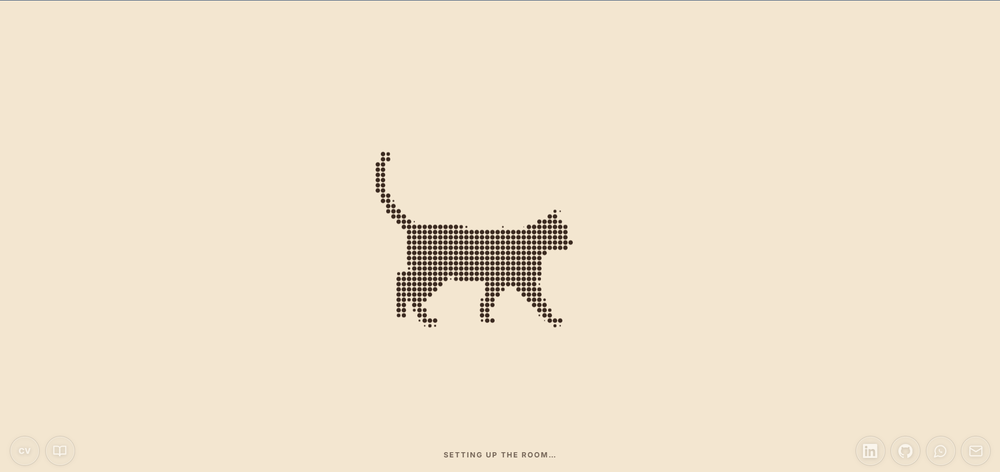
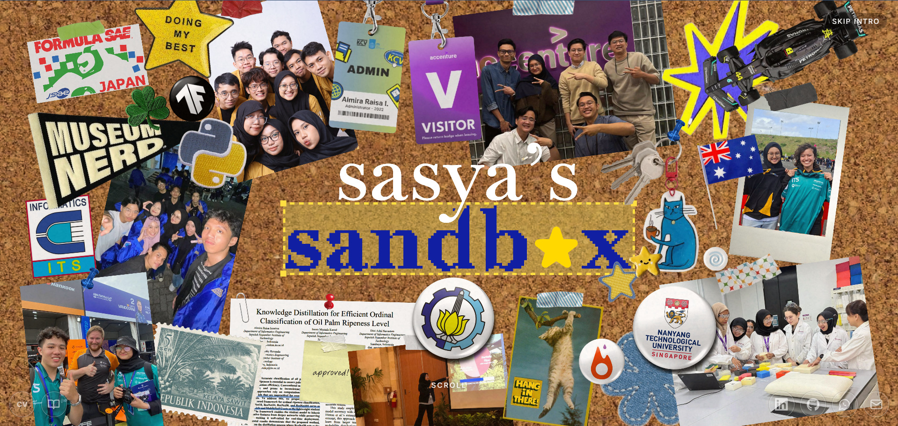
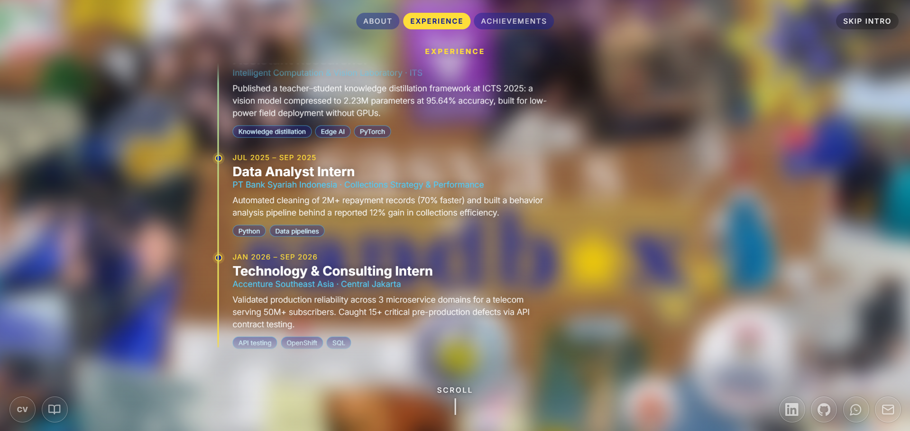
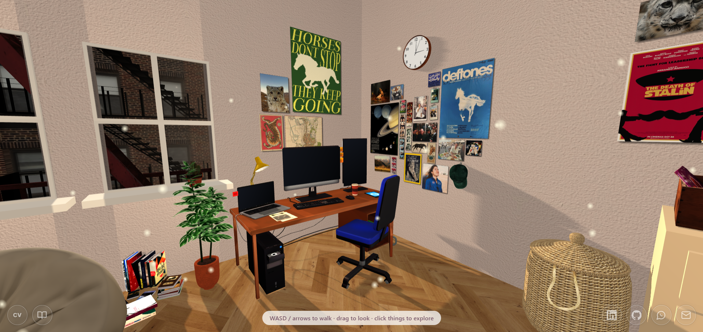
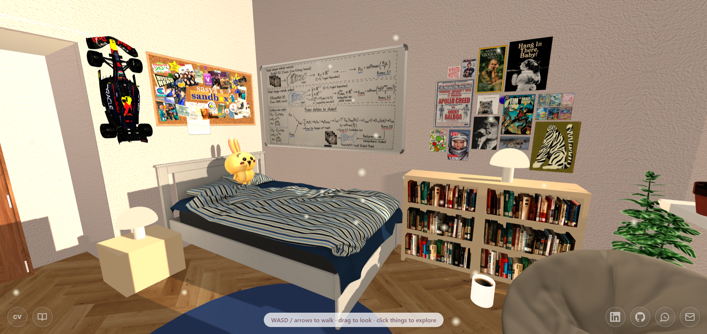

# Sasya's Sandbox

**An interactive 3D portfolio you can walk around in.**
Scroll through a story-style intro, step into a cozy dorm room, then click the PC to open a tiny Windows-style desktop with a working browser, a game, and more.

### 👉 [Live demo](https://almira-ri.vercel.app/)







---

## What you'll find

| Stage | What happens |
|---|---|
| **1. Loader** | A cat video is turned into a live halftone (dot-matrix) animation on a canvas while the room builds. |
| **2. Scroll intro** | Title card → blurred "about" scene with hoverable fun facts → experience timeline → achievements. Jump chips let you skip between sections. |
| **3. 3D room** | Walk around a dorm room built with Three.js. Furniture has collision and shadows, and clickable objects lift slightly on hover. |
| **4. The PC** | Click the monitors to open a full desktop UI with draggable windows, a taskbar, and a start menu. |

### Click around the room

- **Bed** → About me
- **PC** → opens the desktop
- **Whiteboard** → opens projects & paper 

### Inside the desktop

- **Chrome** with four tabs: LinkedIn, GitHub (live contribution graph), Instagram, and the published **research paper** (authors, key results, abstract, keywords, citation)
- **Flappy** (a playable game), **Projects**, **About.txt**, **Terminal**, **Photos**, **Recycle Bin**
- A few "busy updating" filler apps, plus clock, calendar, music, and weather widgets
- Leave with `Esc` or **Start → Shut down**

### Everywhere

- **Guestbook** and a **downloadable CV** (bottom-left), contact links (bottom-right)
- **Mobile friendly**: touch controls, tap-to-walk, a scroll-through intro that fits small screens, and a full-screen desktop on phones

---

## Controls

| Action | Desktop | Touch |
|---|---|---|
| Walk | `W A S D` / arrow keys | Tap the floor |
| Look around | Drag | Drag |
| Interact | Click an object | Tap an object |
| Scroll the intro | Wheel, `↑` `↓`, `Space`, `Home`, `End` | Swipe |
| Continue / skip the intro | Click, `Enter`, or **Skip intro** | Tap |
| Leave the desktop | `Esc` or **Start → Shut down** | **Start → Shut down** |
| Flap (game) | `Space` / click | Tap |

---

## Tech stack

- Plain **HTML, CSS, and JavaScript** (ES modules). No framework, no build step.
- [Three.js](https://threejs.org/) r128 + `GLTFLoader`, loaded from a CDN
- `.glb` models for furniture, images for textures
- Optional [Supabase](https://supabase.com/) REST table for a shared guestbook

## Run locally

The project uses ES modules, top-level `await`, and video pixel reads, so it **must be served over HTTP**. Opening `index.html` directly (`file://`) will not work.

```bash
git clone https://github.com/almirari/sandbox.git
cd sandbox
npx serve .
```

Open the printed URL (usually `http://localhost:3000`). Any static server works: VS Code Live Server, `python -m http.server`, etc.

**Requirements:** a modern browser with WebGL and top-level `await` (current Chrome, Edge, Firefox, or Safari 15+).

---

## Project structure

```
.
├── index.html           # page shell, intro text + fun facts, contact dock
├── style.css            # base styles, terminal popup, contact dock
├── loading.css          # loader + scroll intro
├── extras.css           # timeline, achievements, jump chips, CV/guestbook dock
├── desktop.css          # PC desktop UI
├── js/
│   ├── main.js          # boot, renderer, input, movement, main loop
│   ├── room.js          # builds the room and places all furniture
│   ├── models.js        # .glb loading helpers (caching, auto-scaling)
│   ├── intro.js         # scroll-driven intro (one `progress` value drives everything)
│   ├── loader.js        # halftone cat loader
│   ├── desktop.js       # Windows-style desktop and its apps
│   ├── dock.js          # CV button + guestbook
│   ├── flappy.js        # the game
│   ├── ui.js            # terminal-style popup
│   ├── content.js       # about, projects, paper, contact links
│   └── story.js         # experience timeline + achievements
├── models/              # .glb files + source.md (credits and licenses)
└── textures/            # images, icons, videos, CV
```

### How it fits together

- **The intro is one number.** `intro.js` smooths wheel, touch, and key input into a single scroll `progress` (0 → 1) and renders every frame from it. Each section is just a range of that value, so reordering or retiming a section means changing a few numbers. Only `opacity` and `transform` are animated, which keeps it on the GPU.
- **Loading is non-blocking.** The cat loader plays while the room is built and warmed up (shaders compiled, textures uploaded) *behind* the intro, so entering the room never stutters.
- **Models are measured, not hard-coded.** `loadModel` scales each `.glb` to a target height or length, then `room.js` snaps it flush to walls or desks using its real bounding box. Any model you drop in will sit correctly without fiddling with offsets.

---

## Customize

| What | Where |
|---|---|
| About text, projects, paper details, contact links | `js/content.js` |
| Experience timeline and achievements | `js/story.js` |
| Intro "about" text and hover fun facts | `index.html` (the `.beat.intro` block) |
| LinkedIn, GitHub, Instagram tabs and desktop widgets | top of `js/desktop.js` |
| Contact icons (bottom-right) | `<nav id="dock">` in `index.html` |
| CV file path | `CV_FILE` in `js/story.js` |
| Guestbook database | `GUESTBOOK` at the top of `js/dock.js` |
| Colors | CSS variables at the top of `desktop.css`; story colors in `extras.css` |

**Palette:** yellow `#ffdd3a` · sky `#55c9f2` · blue `#4f77ff` · navy `#101e96`

### Common tasks

**Add an Instagram post.** Drop the image in `textures/` and add it to `INSTAGRAM.posts` in `js/desktop.js`. Use `{ img, url }` to link a specific post.

**Add an achievement.** Add an entry to `ACHIEVEMENTS` in `js/story.js` (oldest first) and put the issuer's logo in `textures/`. If the logo is missing, the issuer's first letter shows instead.

**Add furniture.** Drop a `.glb` into `models/` and call
`loadModel(scene, 'models/name.glb', { x, y, z, height, ry })` in `js/room.js`. Make it clickable with `on(mesh, 'Label', actions.something)`.

**Set up the shared guestbook.** By default, notes live in each visitor's browser only. To share them, fill in `GUESTBOOK.url` and `GUESTBOOK.anonKey` in `js/dock.js`, then create a `guestbook` table with `id`, `name`, `message`, and `created_at`, plus insert and select policies for the anon role. The form has a honeypot field and a 30-second cooldown, but consider adding rate limiting on the database side for a public site.

---

## Assets

Missing icons fall back to emoji and missing photos fall back to gradients, so the site works while you add assets.

<details>
<summary>Expected files</summary>

**Project root:** `title.png`, `title-portrait.png`, `main.png`, `main-portrait.png`

**`models/`:** `plant`, `cactus`, `door`, `shoerack`, `window`, `building`, `fireescape`, `pc`, `architectlamp`, `bed`, `bookshelf`, `rb19`, `usagi`, `laundrybasket`, `recordplayer`, `vinyls`, `clock`, `hat`, `bean_bag`, `books`, `coffeemug`, `ceilinglight` (all `.glb`)

**`textures/`:** `floor.jpg`, `wall.avif`, `corkboard.png`, `vinylposter.png`, `christinakoch.png`, `pcposter.png`, `booknook.png`, `cat.mp4`, `cat-small.mp4`, `cv.pdf`, `cv.png`, desktop app icons (`chrome.png`, `files.png`, …), LinkedIn/Instagram images (`me.jpeg`, `li-banner.jpeg`, `ig1.jpg`, …), issuer logos (`issuer-*.png`), and tab icons (`tab-*.png`)

</details>

**Performance tips:** keep textures under about 2 MB each (`.webp` or `.jpg` where possible) and compress `.glb` files. On touch devices the renderer automatically drops antialiasing, lowers pixel ratio, and shrinks the shadow map.

---

## Troubleshooting

| Problem | Fix |
|---|---|
| Blank page or console errors about modules | You opened the file directly. Serve it over HTTP (see [Run locally](#run-locally)). |
| Cat loader shows only paper color | Check that `textures/cat-small.mp4` exists and is H.264. Browsers can't read frames from some codecs. |
| A model doesn't appear | Check the file name and case (`Plant.glb` ≠ `plant.glb` on Vercel) and look for `could not load` in the console. |
| Furniture faces the wrong way or floats | Adjust `ry`, or the named constants above that `loadModel` call in `room.js` (most have a comment saying which values to try). |
| GitHub tab has no contribution graph | It's fetched live from a third-party API. If you're offline or the API is down, the graph is skipped. |
| Page feels slow on a phone | Lower texture sizes first, then reduce `CELL`/`FPS` in `js/loader.js`. |

---

## Credits

- 3D models: author, source, and license for each model are listed in models/source.md
- Fonts: [Inter](https://rsms.me/inter/), [Fraunces](https://fonts.google.com/specimen/Fraunces), [Caveat](https://fonts.google.com/specimen/Caveat), [JetBrains Mono](https://www.jetbrains.com/lp/mono/)
- Contribution graph data: [github-contributions-api](https://github.com/grubersjoe/github-contributions-api)
- Built with [Three.js](https://threejs.org/)

## Author

**Almira Raisa Izzatina**
[LinkedIn](https://www.linkedin.com/in/almira-ri) · [GitHub](https://github.com/almirari) · [Email](mailto:almirari004@gmail.com)

<!-- ## License

Code: add a license here (for example MIT). Content, photos, logos, 3D models, and the research paper belong to their respective owners. -->